<div align="center">

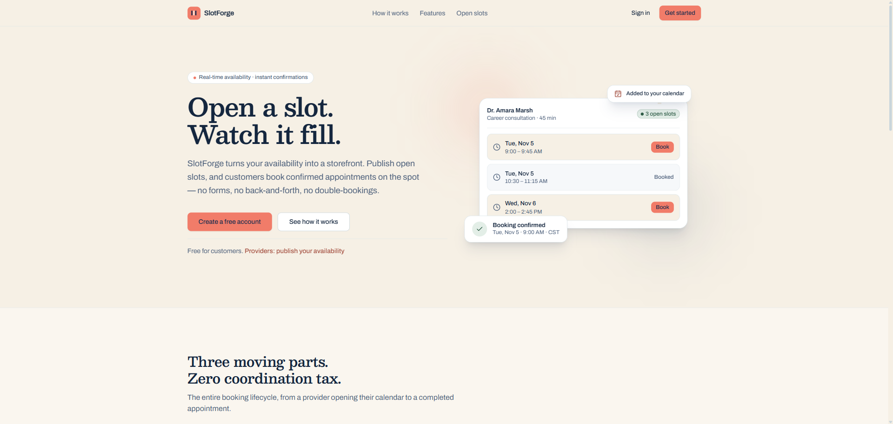

# SlotForge

**Open a slot. Watch it fill.**

SlotForge turns a provider's availability into a storefront: providers publish open time
slots, customers see genuinely available times and book instantly — no request queues, no
back-and-forth messaging, and no double-booking, because the database itself enforces the
calendar.

[Live app](https://slotforge-frontend.onrender.com) · [API](https://slotforge-api.onrender.com) · [Docs](#getting-started)


</div>

---

## Contents

- [What SlotForge is](#what-slotforge-is)
- [Visual showcase](#visual-showcase)
- [Architecture](#architecture)
- [Key features](#key-features)
- [Technical highlights](#technical-highlights)
- [Tech stack](#tech-stack)
- [Getting started](#getting-started)
- [API overview](#api-overview)
- [Testing](#testing)
- [Deployment](#deployment)
- [Project structure](#project-structure)
- [Limitations and roadmap](#limitations-and-roadmap)
- [Author](#author)

## What SlotForge is

**The problem.** Small service businesses — clinics, consultants, tutors — coordinate
appointments over phone tag and DMs. Every "does Tuesday 9:00 work for you?" exchange is a
chance to lose the customer, and every hand-maintained calendar is a chance to book the
same hour twice.

**The approach.** SlotForge is a two-sided booking platform built on *real-time slot
publishing*. Providers open concrete, bookable time slots; customers browse live
availability and confirm an appointment in a single interaction. What the customer sees is
the provider's actual availability — enforced by PostgreSQL constraints, not by UI
optimism.

**Who it's for.**

- **Customers** discover providers, see only genuinely open slots, and manage their
  bookings — reschedule and cancel included.
- **Providers** get a workspace to publish availability (one-off and recurring), block off
  time, and manage incoming bookings through a shared status vocabulary.

**The core workflow.** A provider publishes slots (individually or as a recurring weekly
rule). A customer finds the provider, picks an open slot, and books it — the booking is
confirmed in the same transaction that reserves the slot and creates notifications for
both sides. Either side can cancel; the customer can reschedule into any other open slot.
Providers close the loop by marking visits completed or no-shows.

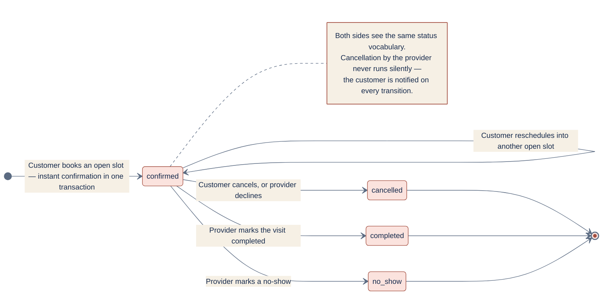

*(Source: [docs/diagrams/booking-workflow.mmd](docs/diagrams/booking-workflow.mmd). The
schema also defines a `pending` status, but the API books slots as `confirmed`
immediately.)*

## Visual showcase

All screenshots are from the running application.

<div align="center">

**Public landing page — availability preview, sign-in, and registration**


</div>

### Provider availability management

<div>

| | |
|---|---|
| 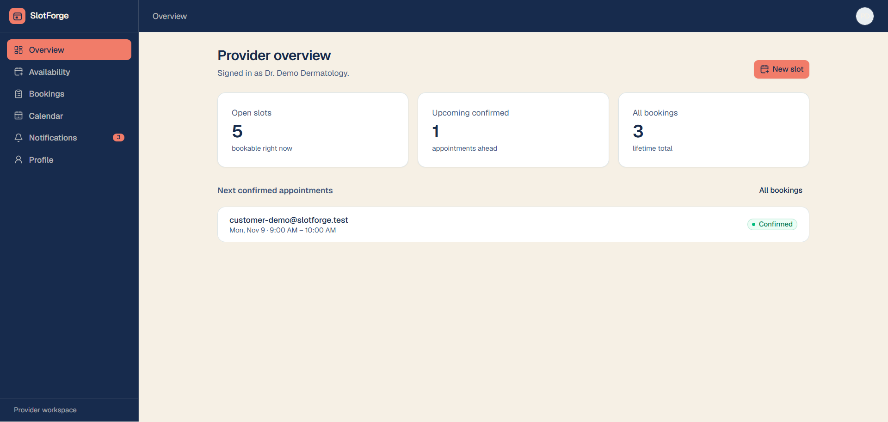 <sub>**Workspace overview** — open slots, upcoming confirmed appointments, lifetime bookings.</sub> | 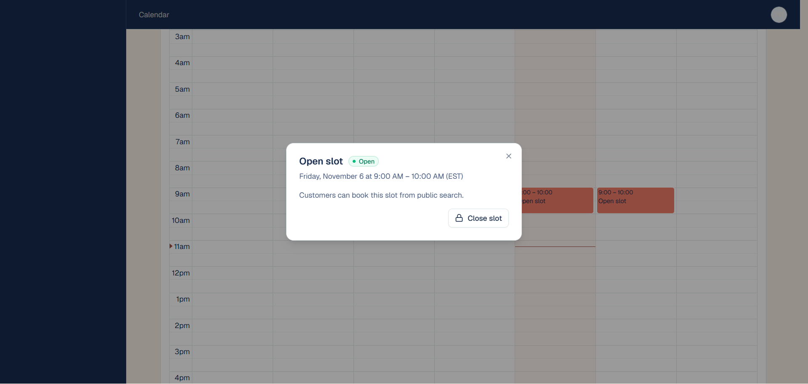 <sub>**Publishing a slot** — pick a window; or define a recurring weekly rule.</sub> |

</div>

<div align="center">

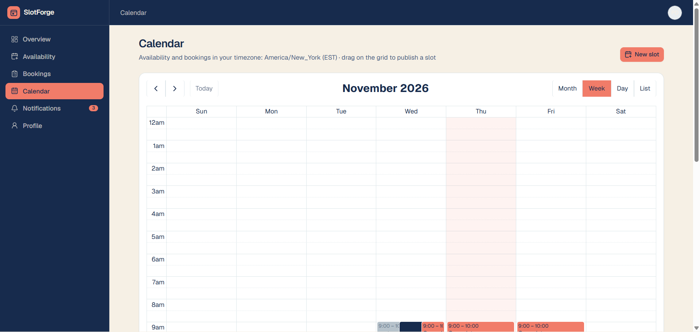

<sub>**Calendar** — month view of availability and bookings (FullCalendar).</sub>

</div>

### Booking workflow — reschedule in three steps

<div>

| | | |
|---|---|---|
| 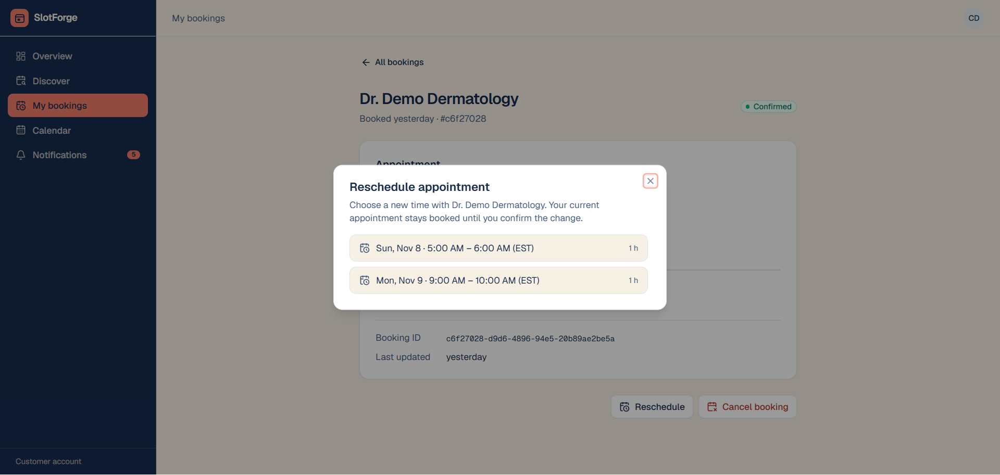 <sub>**1. Pick a booking**</sub> | 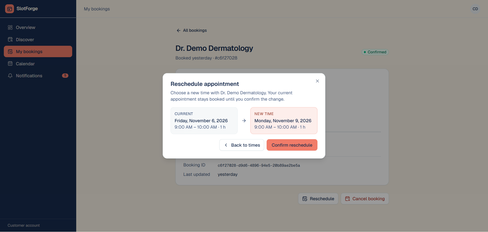 <sub>**2. Choose a new slot**</sub> | 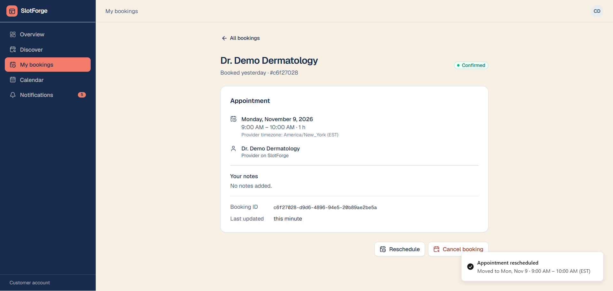 <sub>**3. Both calendars update**</sub> |

</div>

<div align="center">

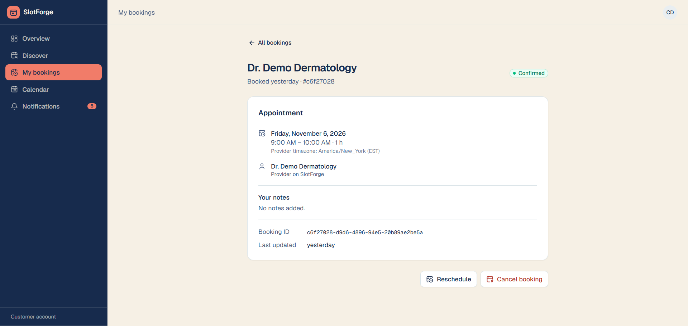

<sub>**Booking detail** — timezone-explicit times, booking ID, reschedule/cancel actions.</sub>

</div>

### Customer dashboard

<div>

| | |
|---|---|
| 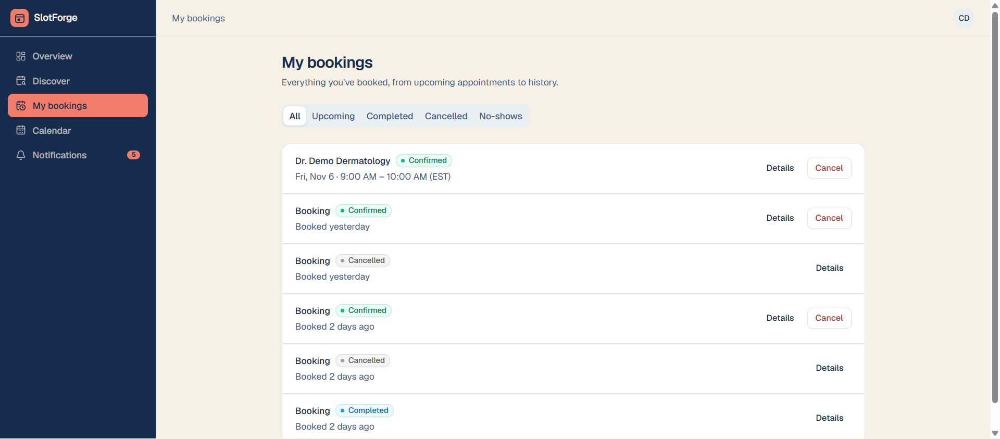 <sub>**My bookings** — status filters across upcoming, completed, cancelled, and no-shows.</sub> | 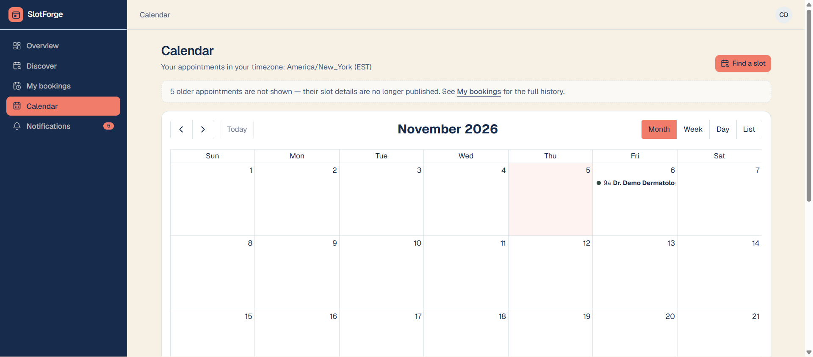 <sub>**Calendar** — appointments in the viewer's timezone.</sub> |

</div>

<div align="center">

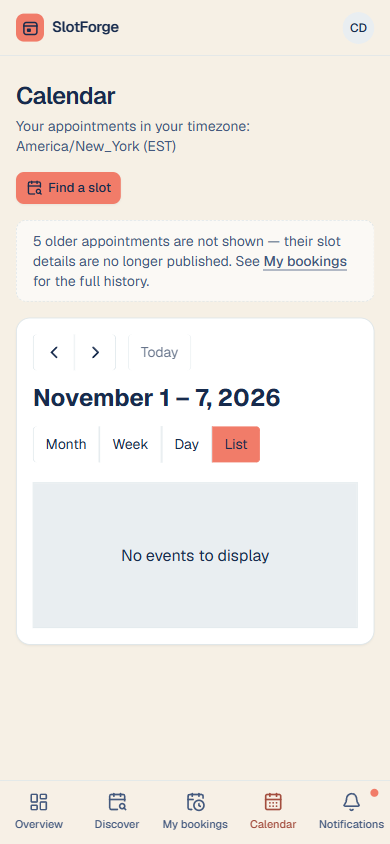

<sub>**Responsive** — the same shell on mobile.</sub>

</div>

## Architecture

SlotForge is a classic two-service web stack with a same-origin security model: the Go
API exposes **no CORS**, and *all* client traffic is proxied through the Next.js origin.
The browser only ever talks to one hostname.

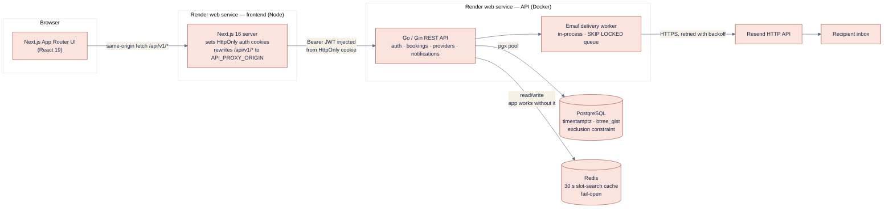

*(Source: [docs/diagrams/architecture.mmd](docs/diagrams/architecture.mmd))*

How the pieces fit together:

- **Auth transport.** The Go API is stateless Bearer-token auth. The Next.js server holds
  the tokens in `HttpOnly`, `SameSite=Lax` cookies (`Secure` in production) and its
  middleware injects `Authorization: Bearer …` onto proxied `/api/v1/*` requests — so JWTs
  never touch browser JavaScript. (`frontend/src/proxy.ts`,
  `frontend/src/lib/server/auth-cookies.ts`)
- **Data layer.** PostgreSQL stores everything as `timestamptz` (UTC instants); a
  `btree_gist` exclusion constraint makes overlapping open slots physically impossible.
- **Caching.** Redis caches only the public slot-search endpoint (30 s TTL) and is
  invalidated by every mutation that changes availability. Redis failing never fails a
  request — the API falls back to PostgreSQL.
- **Email.** A worker inside the API process drains a `notification_deliveries` queue and
  calls Resend over HTTPS. Without Resend credentials the worker simply doesn't start and
  notifications remain in-app. *(See [Limitations](#limitations-and-roadmap) for the
  delivery-semantics caveat.)*
- **Data model.** Eight tables —
  `users`, `provider_profiles`, `availability_slots`, `bookings`, `refresh_tokens`,
  `notifications`, `notification_deliveries`, `provider_unavailable_periods`:

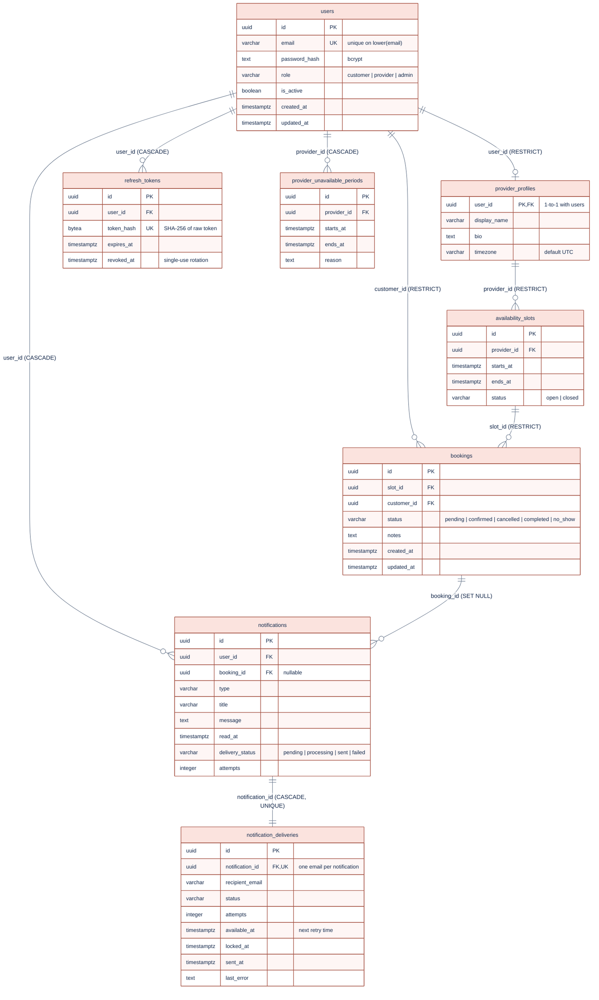

*(Source: [docs/diagrams/database-er.mmd](docs/diagrams/database-er.mmd); schema lives in
[migrations/](migrations/).)*

## Key features

All features below are implemented in this repository, and each of these behaviors is
exercised by the test suites described under [Testing](#testing).

- **JWT authentication with refresh-token rotation.** 15-minute HS256 access tokens;
  7-day refresh tokens (256-bit random) stored only as SHA-256 hashes and rotated
  single-use on every refresh. Logout revokes server-side, idempotently.
- **Role-scoped workspaces.** Customers get discovery + booking management; providers get
  an availability/bookings workspace. Self-registration always creates customers; provider
  accounts are provisioned deliberately (seed script). Cross-user access returns **404,
  not 403** — resource existence is never leaked.
- **Provider availability management.** Create, list, and close individual slots; publish
  public profiles; block off unavailable periods (vacations, meetings) that refuse new
  bookings and reschedules — without ever silently cancelling confirmed ones.
- **Recurring availability.** Weekly rules ("Mon/Wed 9:00–12:00") expanded into concrete
  slots over a date range in the provider's IANA timezone, up to 90 days / 500 slots per
  request. Re-running a rule is idempotent.
- **Public discovery.** `/api/v1/providers` and `/api/v1/slots` are open, cached, and
  pagination-ready: browse provider profiles and genuinely open slots without an account.
- **Booking lifecycle.** Instant confirmation on booking, customer cancellation and
  rescheduling (same-slot reschedules are idempotent no-ops), provider status transitions
  (`confirmed → completed / no_show / cancelled`) with strict transition validation.
- **Double-booking prevention.** Two independent layers: an explicit
  `SELECT … FOR UPDATE` protocol in every booking transaction, plus a PostgreSQL
  exclusion constraint and a partial unique index as the final arbiter (see
  [Technical highlights](#technical-highlights)).
- **Notifications.** Every booking mutation creates in-app notifications for both sides
  *inside the same database transaction*, so a notification can never describe something
  that didn't happen. An email delivery queue with exponential-backoff retries sits on
  top (at-least-once semantics).
- **Redis caching with fail-open.** The public slot search is cached for 30 s and
  invalidated on every availability mutation. If Redis is down, the API logs a warning
  and serves from PostgreSQL — readiness reporting degrades gracefully instead of the
  service going down.
- **API security.** Security headers on every response (`HSTS`, `X-Frame-Options: DENY`,
  `nosniff`, referrer policy), request IDs for log correlation, per-account login
  throttling (10 failed attempts per 5 minutes, keyed by email), bcrypt password hashing,
  parameterized SQL throughout, and a same-origin proxy design with no CORS surface.

## Technical highlights

The engineering decisions that make SlotForge's calendar *honest* — the backend
guarantees that let the UI never lie:

### 1. A database exclusion constraint is the source of truth

```sql
ALTER TABLE availability_slots
  ADD CONSTRAINT availability_no_overlap
  EXCLUDE USING gist (
    provider_id WITH =,
    tstzrange(starts_at, ends_at, '[)') WITH &&
  ) WHERE (status = 'open');
```

No amount of application logic can create two overlapping *open* slots for the same
provider — not a race, not a bug, not a misbehaving client. The half-open `tstzrange`
means a slot ending at 10:00 and one starting at 10:00 don't collide, and the `WHERE`
clause leaves closed slots free to overlap history. The API maps the Postgres `23P01`
violation to a friendly `409`.

### 2. Layered concurrency control for bookings

Booking creation, cancellation, and rescheduling all follow one documented lock protocol:
**lock the target slot first (`SELECT … FOR UPDATE`), then the booking row** — a fixed
order that makes competing reschedules into the same slot serialize instead of
deadlocking. Re-validation happens inside the transaction (slot open? not blocked? not
booked?), and because locks alone don't survive every race, a **partial unique index** —
`UNIQUE (slot_id) WHERE status IN ('pending','confirmed')` — stands as the final arbiter;
a lost race maps to `409 Conflict`, not a corrupt calendar. Slot, booking,
notifications, and delivery rows commit or roll back **atomically**. Verified by
integration tests that repeatedly race concurrent bookings at one slot: exactly one
`201`, the rest `409`.

### 3. Caching is an optimization, never a dependency

Only the public slot-search endpoint is cached (30 s TTL, versioned keys). Invalidation
is explicit and mutation-driven: booking create/cancel/reschedule and slot
create/close/reschedule all scan-and-delete the affected key space. Every Redis error
path fails open — degraded readiness, full correctness.

### 4. Refresh tokens are single-use and hashed at rest

Refresh rotation revokes the old token and inserts the new one **in one transaction**, so
a replayed refresh token can't double-spend a session. Tokens are stored as SHA-256
digests — a database leak yields nothing usable. Access tokens live 15 minutes and never
reach JavaScript (see [Architecture](#architecture)).

### 5. Recurring availability that respects timezones and DST

Recurring rules are expanded in the provider's IANA timezone using Go's `time.Date`
semantics: a wall-clock time inside a spring-forward gap resolves to the instant after
the gap; a repeated fall-back time resolves to its first occurrence. Results are stored
as UTC `timestamptz` instants — so a slot is the same instant everywhere, forever. The
API embeds `time/tzdata` so timezone data survives scratch containers, and batch
insertion is transactional: a rule that would overlap existing slots rolls back whole,
while exact duplicates are skipped (idempotent re-runs).

### 6. Forward-only migrations with a hardened runner

Six plain SQL migrations, filename-tracked in a `schema_migrations` table, each applied
in its own transaction. The runner (`frontend/scripts/apply-migrations.mjs`) is idempotent,
strips unreliable `sslmode` URL params and enforces TLS with certificate validation for
any non-local host, refuses to run against production without an explicit `--production`
flag (which only accepts the dedicated `SLOTFORGE_DB_URL` variable), and scrubs
credentials from its output.

### 7. A delivery queue designed for exactly-one worker — or ten

Email deliveries are claimed with `FOR UPDATE SKIP LOCKED` and marked `processing` with a
lock timestamp, so multiple workers can share the queue safely. Failures retry with
exponential backoff (30 s doubling, capped at 1 h, 5 attempts max); claims that stall are
recovered by a reaper after 5 minutes. Delivery is honestly **at-least-once** — a crash
between "provider accepted" and "mark sent" can produce a duplicate email, and the code
says so rather than pretending otherwise.

## Tech stack

| Layer | Technologies |
|---|---|
| **Frontend** | Next.js 16 (App Router, Turbopack), React 19, TypeScript, Tailwind CSS 4, Radix UI primitives, FullCalendar 7 (Temporal-based, `temporal-polyfill`), react-hook-form + zod, motion, sonner |
| **Backend** | Go 1.26, Gin 1.12, pgx v5 (PostgreSQL driver), go-redis v9, golang-jwt v5, embedded `time/tzdata` |
| **Database** | PostgreSQL 16+ (Docker Compose ships 16; Render currently runs 18) — `btree_gist`, partial indexes, `timestamptz` everywhere |
| **Infrastructure** | Docker (multi-stage, non-root alpine image for the API), Docker Compose (local PostgreSQL + Redis), Render (web services, Key Value, managed PostgreSQL) |
| **Testing & tooling** | Go testing + PostgreSQL integration suites, Vitest (jsdom), React Testing Library, Playwright (journeys + axe accessibility scans), ESLint, `go vet`, TypeScript strict |

## Getting started

### Prerequisites

- **Go 1.26+**
- **Node.js 20+** and npm (Render runs the frontend on Node 22)
- **Docker** (for local PostgreSQL and Redis)

### 1. Clone and configure

```bash
git clone https://github.com/PriyanshuNaredi/slotforge.git
cd slotforge

cp .env.example .env
```

Fill in `.env` (local values only — never commit it):

- `DATABASE_URL` — points at the Compose PostgreSQL (`localhost:5432`, database
  `slotforge`); its password **must match** `POSTGRES_PASSWORD`
- `JWT_SECRET` — any string of at least 32 characters (local dev value)
- `RESEND_API_KEY` / `EMAIL_FROM` — leave empty to run without email delivery

### 2. Start PostgreSQL and Redis

```bash
docker compose up -d   # postgres:16-alpine on :5432, redis:7-alpine on :6379
```

> Note: Postgres reads `POSTGRES_PASSWORD` only when its volume is first initialized. To
> change it later, remove the volume (`docker compose down -v`) — this deletes local data.

### 3. Run migrations and start the API

```bash
node frontend/scripts/apply-migrations.mjs "$DATABASE_URL"   # or let it read .env
go run ./cmd/api                                             # serves :8080
```

The API exposes `/healthz` (liveness) and `/readyz` (checks the database connection, the
expected tables, all applied migrations, and Redis health).

### 4. Start the frontend

```bash
cd frontend
npm install
cp .env.example .env.local   # points the API proxy at http://127.0.0.1:8080
npm run dev                  # http://localhost:3000
```

### 5. Seed a demo provider

Self-registration always creates customers, so providers are provisioned with a seed
script (passwords follow the backend rule: minimum 12 characters):

```bash
cd frontend
node scripts/seed-provider.mjs --email provider@example.com --password "at-least-12-chars" --name "Dr. Example" --slots 3
```

Register a customer through the UI, book one of the seeded slots, and you have a full
two-sided demo running locally.

### Tests

```bash
# Backend — unit tests always run; PostgreSQL integration tests auto-skip
# unless DATABASE_URL is set (point it at any disposable database):
go test ./... -count=1
go vet ./...

# Frontend
cd frontend
npm run test                                   # Vitest
npx tsc --noEmit && npx eslint src && npm run build
```

**Playwright E2E** runs against its own isolated local stack (the config does not manage
it — start both pieces first):

1. Create a disposable `slotforge_e2e` database and run the API on port **8081** with
   `DATABASE_URL` pointed at it.
2. Start the frontend dev server on port **3100** with `API_PROXY_ORIGIN=http://127.0.0.1:8081`.
3. Seed the E2E provider row: `node scripts/e2e-seed.mjs` (it prints the credentials it
   generated).
4. Run the suites: `npx playwright test` (8 user-journey tests + accessibility scans
   with `@axe-core/playwright`, single worker, no retries).

### Troubleshooting

- **API exits immediately at startup** — `JWT_SECRET` must be at least 32 characters.
- **Compose Postgres ignores your password change** — `POSTGRES_PASSWORD` is read only
  when the volume is first created; `docker compose down -v` resets it (deletes local data).
- **Integration tests finish instantly with no results** — they skip by design when
  `DATABASE_URL` is unset; point it at a disposable database to actually run them.
- **Frontend can't reach the API** — check `API_PROXY_ORIGIN` in `frontend/.env.local`;
  locally it must be `http://127.0.0.1:8080`.

## API overview

Base path: `/api/v1` — see the registration in
[cmd/api/main.go](cmd/api/main.go). All protected routes require
`Authorization: Bearer <access token>`.

| Group | Endpoints | Source |
|---|---|---|
| **Auth** | `POST /auth/register`, `POST /auth/login`, `POST /auth/refresh`, `POST /auth/logout` | [internal/auth/handler.go](internal/auth/handler.go) |
| **Public discovery** | `GET /providers`, `GET /providers/:id`, `GET /slots`, `GET /slots/:id` | [internal/providers/handler.go](internal/providers/handler.go), [internal/bookings/discovery_handler.go](internal/bookings/discovery_handler.go) |
| **Bookings (customer)** | `POST /bookings`, `GET /bookings`, `GET /bookings/:id`, `PATCH /bookings/:id/cancel`, `PATCH /bookings/:id/reschedule` | [internal/bookings/handler.go](internal/bookings/handler.go) |
| **Provider workspace** | `POST /providers/profile`, `GET /providers/profile/me`, `POST /providers/slots`, `POST /providers/slots/recurring`, `GET /providers/slots`, `GET /providers/slots/:id`, `PATCH /providers/slots/:id/close`, `GET /providers/bookings`, `PATCH /providers/bookings/:id/status`, `POST|GET /providers/unavailability`, `DELETE /providers/unavailability/:id` | [internal/providers/handler.go](internal/providers/handler.go) |
| **Notifications** | `GET /notifications`, `GET /notifications/unread-count`, `PATCH /notifications/:id/read`, `PATCH /notifications/read-all` | [internal/notifications/handler.go](internal/notifications/handler.go) |
| **Health** | `GET /healthz` (liveness), `GET /readyz` (database, migrations, Redis) | [internal/health/handler.go](internal/health/handler.go) |

Error semantics worth noting: conflicting operations return `409` (slot taken, slot
overlapping), foreign resources return `404` (no existence leak), and validation errors
return `400` with machine-readable codes.

## Testing

The test suite is layered, mirroring the system's risk profile:

- **Go unit tests** (all `internal/` packages) run everywhere with no dependencies —
  auth token lifecycle, login throttling, recurring-rule expansion (including DST
  spring-forward and fall-back cases), status-transition tables, email rendering.
- **Go integration tests** run against a real PostgreSQL (auto-skipped without
  `DATABASE_URL`) and cover the things mocks can't: **concurrent booking races**
  (10 workers, one slot, exactly one winner), cross-module concurrency, transaction
  rollback paths, cache invalidation, zero-UUID regressions, and authorization scoping.
- **Vitest** covers frontend logic — calendar event math, the API client's refresh
  handling, dialog state machines, form validations, timezone formatting — via
  React Testing Library where components are involved.
- **Playwright** drives the real stack end-to-end: registration → discovery → booking →
  conflict rejection → reschedule → provider lifecycle → notifications → logout, plus
  axe accessibility scans (WCAG 2.AA-level rules) over the public pages, keyboard and
  focus checks.

## Deployment

SlotForge deploys to [Render](https://render.com) via the blueprint in
[render.yaml](render.yaml) — one click creates the whole topology:

| Service | Type | Notes |
|---|---|---|
| **API** | Docker web service | Built from the repo `Dockerfile` (non-root alpine); health check `/healthz` |
| **Frontend** | Node web service | Root dir `frontend/`, Node 22; rewrites `/api/v1/*` to `API_PROXY_ORIGIN` |
| **Redis** | Managed Key Value | Slot-search cache; the API fails open without it |
| **PostgreSQL** | Managed database | Migrations are applied by the runner, not auto-run |

Deployment-relevant facts:

- `JWT_SECRET` is generated by the blueprint; `RESEND_API_KEY` and `API_PROXY_ORIGIN`
  must be set in the dashboard (marked `sync: false`).
- **`API_PROXY_ORIGIN` is baked into the frontend at build time** — changing it requires
  a rebuild. The build warns loudly if it's unset in production.
- **Apply migrations before deploying code that needs them**: `node
  frontend/scripts/apply-migrations.mjs --production` (uses `SLOTFORGE_DB_URL` only, and
  enforces TLS).
- `/readyz` is the honest source of truth in production: it reports the database
  connection, table set, applied migrations, and Redis state.
- **Free-tier caveats:** services sleep after ~15 minutes idle (the first request wakes
  them), and the free PostgreSQL plan has **no managed backups and a limited lifetime** —
  take scheduled `pg_dump` archives (see
  [docs/DATABASE_RECOVERY.md](docs/DATABASE_RECOVERY.md)) and plan an upgrade before the
  instance expires.

Operational detail — incident triage, log events, rollback, and the backup/restore
procedure — lives in [docs/OPERATIONS_RUNBOOK.md](docs/OPERATIONS_RUNBOOK.md).

## Project structure

```
slotforge/
├── cmd/api/                  # Entrypoint: route table, middleware chain, worker lifecycle
├── internal/
│   ├── auth/                 # JWT issue/verify, refresh rotation, login throttle, middleware
│   ├── bookings/             # Booking lifecycle, public slot search + caching
│   ├── providers/            # Profiles, slots, recurring rules, unavailability
│   ├── notifications/        # In-app notifications, delivery queue, Resend client, worker
│   ├── cache/                # Redis client + invalidation helpers
│   ├── config/               # Environment configuration
│   ├── database/             # pgx pool setup
│   ├── health/               # /healthz and /readyz
│   └── logging/              # Request IDs, structured JSON logs, security headers
├── migrations/               # 001–006, forward-only SQL
├── frontend/
│   ├── src/app/              # App Router: (marketing), (auth), dashboard/*, provider/*
│   ├── src/components/       # customer / provider / marketing / shared / radix ui
│   ├── src/lib/              # API client, server auth cookies, formatting, validation
│   ├── e2e/                  # Playwright journeys + accessibility specs
│   └── scripts/              # apply-migrations.mjs, seed-provider.mjs, e2e-seed.mjs
├── docs/                     # Runbook, security review, known limitations, recovery, diagrams
├── docker-compose.yml        # Local PostgreSQL 16 + Redis 7
├── Dockerfile                # Production API image (multi-stage, non-root)
└── render.yaml               # Render blueprint: API, frontend, Redis, PostgreSQL
```

## Limitations and roadmap

Honest accounting — **implemented** is above; everything here is **not** built:

**Operational (free tier)**
- Single API instance: deploys and crashes interrupt in-flight requests; free services
  sleep when idle.
- The free PostgreSQL plan has no managed backups/PITR and expires — recovery today is
  manual `pg_dump` archives.
- Observability is structured JSON logs + `/readyz`; no metrics endpoint yet.
- The live deployment's provider directory is intentionally empty — seed a local stack to
  explore with demo data.

**Product scope**
- Email delivery is **at-least-once** (duplicates are possible by design) and requires
  Resend credentials; without them, notifications are in-app only.
- Provider profiles support create + read only (no update endpoint); provider accounts
  are seeded, not self-serve.
- Slots are single-appointment (no capacity/group bookings); blocking a window that
  overlaps active bookings is refused rather than silently cancelling them.
- Notifications are pull-based (60 s unread polling + event-driven refresh); no push.
- No admin role surface beyond the database-level role.

**Security**
- Per-account login throttling means an attacker can lock a victim's account for rolling
  5-minute windows; no MFA.
- Only the login endpoint is throttled — public discovery endpoints rely on
  infrastructure-level limits.

**Natural next steps** (none in progress): rate limiting on public endpoints, provider
profile updates, push notifications, MFA, capacity-based slots, and a metrics endpoint.

## Author

**Priyanshu Naredi** — MS Computer Science, Syracuse University.

Building SlotForge as a production-grade exploration of what it takes to make a calendar
*provably* honest: concurrency control you can race-test, constraints you can't trick,
and infrastructure that degrades gracefully.

- GitHub: [@PriyanshuNaredi](https://github.com/PriyanshuNaredi)
- Project: [PriyanshuNaredi/slotforge](https://github.com/PriyanshuNaredi/slotforge)
